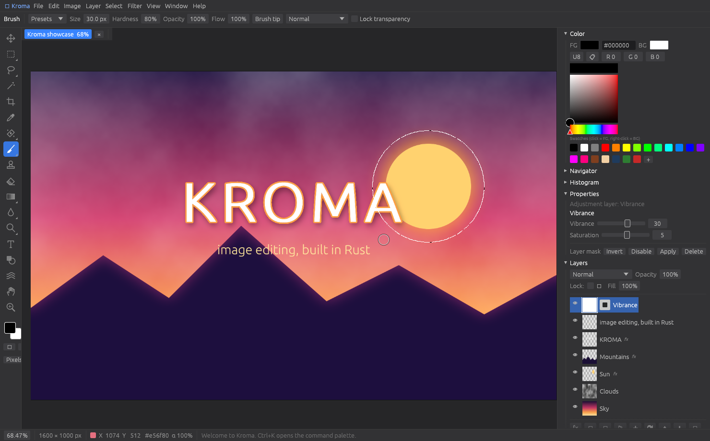

# Kroma

A layered raster image editor written in Rust. Desktop app (Windows, macOS, Linux), a headless engine, and a batch CLI.



## What it does today

- **Layers**: pixel, text, solid/gradient fill, 19 non-destructive adjustment layers, groups (pass-through or isolated), layer masks, clipping masks, opacity + fill opacity, all **27 Photoshop blend modes**.
- **Layer styles**: Drop Shadow, Inner Shadow, Outer Glow, Inner Glow, Bevel & Emboss, Satin, Color Overlay, Gradient Overlay, Stroke.
- **27 tools**: Move, Marquee (rect/ellipse), Lasso, Polygonal Lasso, Magic Wand, Crop, Eyedropper, Spot Healing (content-aware), Healing Brush, Clone Stamp, Brush, Pencil, Eraser, Smudge, Blur, Sharpen, Dodge, Burn, Sponge, Gradient (5 shapes), Paint Bucket, Type, Shapes (rect, rounded, ellipse, polygon, star, line/arrow), Liquify (5 modes), Hand, Zoom.
- **Brush engine** with Photoshop's opacity-vs-flow model, hardness, spacing, angle, roundness, scatter, jitter, pen pressure, presets, lock transparency, painting on masks.
- **Adjustments**: Brightness/Contrast, Levels, Curves, Exposure, Vibrance, Hue/Saturation, Color Balance, Black & White, Photo Filter, Channel Mixer, Temperature & Tint, Selective Color, Gradient Map, Invert, Desaturate, Posterize, Threshold, Solarize, Sepia. Auto Tone / Contrast / Color.
- **37 filters** in 8 groups (Blur, Sharpen, Noise, Stylize, Distort, Pixelate, Render, Other) with live preview, Last Filter.
- **Content-Aware Fill** (multi-scale PatchMatch), Select Subject (contrast heuristic), Color Range, Grow, Similar, Border/Smooth/Expand/Contract/Feather.
- **Transform**: Free Transform (move/scale/rotate, Shift snaps), Distort/Perspective, flip/rotate layer, Image Size (4 resamplers), Canvas Size with anchor, rotate canvas, crop, trim.
- **History** panel with click-to-jump, snapshots, copy-on-write states (cheap memory).
- **Actions**: record, replay, save/load JSON, batch over folders (GUI or CLI).
- **Files**: open PSD (layers, groups, blend modes), save `.kroma` (lossless 16-bit, keeps text/adjustments/styles), OpenRaster `.ora` (GIMP/Krita), import/export PNG, JPEG, WebP, TIFF, BMP, GIF, TGA, ICO, QOI, HDR, EXR. 16-bit PNG/TIFF export.
- **Extras Photoshop does not ship**: command palette (Ctrl+K), parallel batch CLI with JSON recipes, Tilt-Shift, Clarity, Dehaze, Chromatic Aberration filters, export size estimate, atomic saves.

See [FEATURES.md](FEATURES.md) for the honest parity matrix against Photoshop and [ROADMAP.md](ROADMAP.md) for what is next.

## Build and run

Install Rust (https://rustup.rs), then:

```
cargo run --release -p kroma-app          # the editor
cargo run --release -p kroma-app -- a.psd # open files
cargo build --release                     # all binaries into target/release
cargo test --workspace                    # 35 engine tests + 10 headless UI tests
```

Windows builds produce `target\release\kroma-app.exe` and `kroma.exe`. Pushing a tag `v*` to GitHub builds downloadable binaries for all three platforms (see `.github/workflows/ci.yml`).

## CLI

```
kroma actions                                   # list built-in actions
kroma ops                                       # JSON template of every op, adjustment, filter
kroma run --builtin "web ready" -o out/ photos/ # parallel batch, progress per file
kroma run --action my.json -f jpg -q 85 -o out/ *.png
kroma run --op '{"op":"auto_tone"}' --op '{"op":"fit_within","max_width":1600,"max_height":1600}' -o out/ in/
kroma convert design.psd design.kroma
kroma info design.kroma
```

Recipes are plain JSON lists of ops, for example:

```json
[
  {"op": "fit_within", "max_width": 2048, "max_height": 2048},
  {"op": "auto_tone"},
  {"op": "adjust", "adjustment": {"Vibrance": {"vibrance": 0.25, "saturation": 0.0}}},
  {"op": "filter", "filter": {"UnsharpMask": {"amount": 0.6, "radius": 0.8, "threshold": 0.0}}},
  {"op": "watermark", "text": "(c) Studio", "size": 28, "color": {"r":1,"g":1,"b":1,"a":1}, "opacity": 0.6, "anchor": "BottomRight", "margin": 20}
]
```

## Layout

```
crates/kroma-core   engine: buffers, blend, adjust, filter, brush, selection, effects,
                    text, transform, inpaint, document, history, io, ops (no GUI deps)
crates/kroma-app    egui/eframe desktop editor
crates/kroma-cli    `kroma` batch / convert / info
```

Pixels are 32-bit float RGBA, straight alpha, sRGB-encoded (Photoshop's working model). Layer buffers are `Arc` copy-on-write, so a history state only costs memory for layers that changed. Compositing is region-based and multi-threaded (rayon); the canvas uploads only the dirty tiles to the GPU.

## Keyboard

Photoshop defaults: V M L W C I J B S E G R O T U Q H Z, Shift+key cycles tool groups, `[` `]` size, Shift+`[` `]` hardness, 1..0 opacity, X swap, D default colors, Space pan, Ctrl+Z / Ctrl+Shift+Z, Ctrl+J, Ctrl+E, Ctrl+G, Ctrl+T, Ctrl+L, Ctrl+M, Ctrl+U, Ctrl+B, Ctrl+I, Ctrl+Shift+I, Ctrl+A, Ctrl+D, Ctrl+K command palette, F1 shortcut list.
